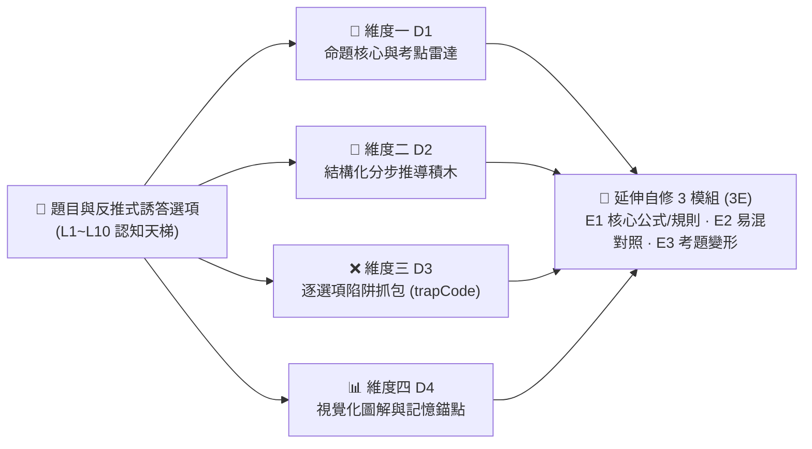

# 🌐 4D 跨學科通用深度出題與視覺化詳解總綱 (4D-Universal Framework)

> **適用科目**：**英文 (KET/PET/文法閱讀)、國語 (字音字形/成語古文/閱讀素養)、自然 (理化/生物/地科實驗)、社會 (歷史/地理/公民)、數學**。  
> **核心目標**：只要將本 `.md` 提供給任何 AI，AI 就能跳脫「死背硬記、湊數選項、純文字流水帳解答」的平庸模式，自動產出 **「有深度、有認知層次（由淺入深 L1~L10）、選項具診斷力、詳解帶視覺化圖表與延伸自修」** 的頂級 4D 題庫。

---

## 一、 什麼是「4D + 3E」深度出題哲學？

一般題庫是 **1D（一維度：只給對錯與一段文字解釋）**，孩子看完詳解只知道「喔，這題選 B」，下次題目換個問法照樣錯。

我們的 **4D（四維診斷）＋ 3E（三模延伸）** 架構，把每一道題目變成一次完整的「家教名師一對一診斷」：



| 結構代號 | 模組名稱 | AI 撰寫時的黃金標準（跨科目通用） |
| :---: | :--- | :--- |
| **D1** | **🎯 命題核心 (`examPurpose`)** | 一句話點破：出題老師在考哪個核心概念？這題表面在問 A，其實在考哪個底層邏輯？ |
| **D2** | **📐 分步推導積木 (`steps` + `insight`)** | 拒絕整段長文！拆成 **「圈關鍵線索 ➔ 套用規則/視覺圖表 ➔ 推導結論」** 的積木步驟，搭配一句 **💡 秒殺口訣 (`insight`)**。 |
| **D3** | **❌ 逐選項陷阱抓包 (`distractorAnalysis`)** | 每個錯誤選項都必須綁定一個 **認知盲點代碼 (`trapCode`)**，具體指出「選這個選項的孩子，心裡誤以為是什麼」。 |
| **D4** | **📊 視覺化圖解心法 (`visualBlock` / `figureNote`)** | 將抽象文字轉為 **時間軸、對照表、結構拆解圖、流程圖或空間示意圖**，用視覺記憶取代死背。 |
| **E1** | **🔑 核心法則 (`coreRules`)** | 提煉本題可帶走的 2~3 條黃金公式、文法結構或科學定律。 |
| **E2** | **⚖️ 易混淆雙胞胎對照 (`conceptCompare`)** | 將最容易搞混的相似字詞、相似文法、相似實驗或歷史事件並排比對。 |
| **E3** | **🔮 段考／檢定變形預測 (`examVariations`)** | 告訴學生：「如果大考把題幹中的 X 改成 Y，答案就會翻轉成 Z！」訓練舉一反三。 |

---

## 二、 五大學科「4D 診斷 ＋ 視覺化詳解」落地規範

不同科目有不同的「思維痛點」與「最佳視覺化工具」。AI 針對各科出題時，必須依下表轉換 4D 內容：

### 1. 🇬🇧 英文科（English — 單字 / 文法 / 劍橋英檢 KET・PET / 閱讀）
- **D1 考點核心**：點出考點是「時態時間軸搭配」、「介系詞空間感」、「連接詞邏輯轉折」還是「母語中式英文干擾」。
- **D2 分步拆解**：`① 抓句中時間/語境訊號詞 (Signal Words)` ➔ `② 判斷主詞單複數/主動被動或前後句因果` ➔ `③ 填入正確結構並朗讀全句`。
- **D3 常見 `trapCode` 庫**：
  - `ENG_TENSE_MISMATCH`（時態與時間副詞衝突，如看到 `since` 卻選過去簡單式）
  - `ENG_CHINGLISH_LITERAL`（中式英文逐字直譯，如「看書」誤用 `look a book`）
  - `ENG_POS_CONFUSION`（詞性誤用，形容詞與副詞、動名詞與不定詞混淆）
  - `ENG_PREP_COLLOCATION`（介系詞搭配錯誤，`in / on / at` 時間或空間誤用）
- **D4 詳解視覺化圖示（必附其一）**：
  - **⏳ 時態時間軸圖 (Timeline Block)**：標出 `Past ─── Now ─── Future`，用色塊畫出「過去持續到現在 (`have + Vpp`)」與「過去某點結束 (`V-ed`)」的視覺差異。
  - **📦 句子結構拆解積木 (Sentence Slot Box)**：`[主詞] + [助動詞] + [原形動詞] + [受詞/時間]` 色塊對齊。
  - **🧭 介系詞空間／程度光譜圖**：如 `at (點) < on (面/特定日) < in (大空間/長期間)` 視覺階梯。
- **英文科專項延伸規範**：完整 10 大英文 `trapCode`、非選擇題（單字聽寫、段落逐句盲聽、公式造句、提綱作文、短文改錯）4D 格式、同源三階映射規則與前端 Schema，詳見專門文件 **[4D_英文科_出題與詳解規範.md](file:///c:/@植善課業/AI/英語學習網頁/4D_英文科_出題與詳解規範.md)**。

---

### 2. 📖 國語科（Chinese — 字音字形 / 成語詞語 / 修辭句型 / 閱讀素養）
- **D1 考點核心**：點出是「形聲字聲旁/形旁辨析」、「成語褒貶與使用情境」、「複句邏輯關係」還是「文意推論（言外之意）」。
- **D2 分步拆解**：`① 圈出題幹情境關鍵詞（正向/負向、對象是誰）` ➔ `② 拆解字形部件或詞語本義` ➔ `③ 比對語境合適度`。
- **D3 常見 `trapCode` 庫**：
  - `CHN_RADICAL_CONFUSE`（部首形旁混淆，如「乾燥」與「急躁」、「松弛」與「奔馳」）
  - `CHN_IDIOM_LITERAL`（成語望文生義，如以為「差強人意」是很差、「首當其衝」是第一名）
  - `CHN_TONE_MISUSE`（褒貶色彩誤用，如把負面成語「處心積慮」拿來稱讚別人努力）
  - `CHN_CONTEXT_OVERINFER`（閱讀過度推論，腦補文章未提及的因果）
- **D4 詳解視覺化圖示（必附其一）**：
  - **🧩 字根部件拆解卡 (Radical Matrix)**：如固定聲旁 `【喿】`，並列 `🔥 火＋喿＝燥（缺水乾熱）`、`🦶 足＋喿＝躁（急得跳腳）`、`💧 水＋喿＝澡（用水洗身）`、`🌳 木＋喿＝噪（鳥在樹上吵）`。
  - **⚖️ 成語正反語境紅綠燈表**：標示「適用對象 / 褒貶色彩 / 常見誤用造句（❌ vs ⭕）」。
  - **🗺️ 閱讀段落結構與情緒曲線圖**：將長文濃縮為 `起因 ➔ 轉折 ➔ 核心主旨` 三格視覺流程圖。

---

### 3. 🔬 自然科（Science — 生物 / 理化 / 地球科學 / 實驗探究）
- **D1 考點核心**：點出考點是「實驗控制變因 vs 操縱變因」、「能量/物質守恆」、「力學平衡」還是「空間相對位置（如月相、四季、岩層）」。
- **D2 分步拆解**：`① 找出實驗中唯一改變的條件（操縱變因）` ➔ `② 追蹤物理/化學變化方向` ➔ `③ 對照數據圖表得出結論`。
- **D3 常見 `trapCode` 庫**：
  - `SCI_VAR_CONFUSION`（操縱變因與應變變因顛倒，或未固定控制變因）
  - `SCI_INTUITION_FALLACY`（生活直覺迷思，如以為「越重的物體一定越沉」、「植物晚上行呼吸作用、白天不行呼吸作用」）
  - `SCI_GRAPH_AXIS_MISREAD`（看錯圖表縱軸/橫軸單位，如把位置-時間圖當成速度-時間圖）
  - `SCI_DIRECTION_REVERSED`（方向顛倒，如風向定義為吹來的方向卻看成吹去的方向、顯微鏡成像上下左右顛倒）
- **D4 詳解視覺化圖示（必附其一）**：
  - **🧪 實驗對照雙欄圖 (Experiment Control Table)**：並排呈現「甲組 vs 乙組」哪些條件相同（🔒 控制變因）、哪一個條件不同（⚡ 操縱變因）、結果差在哪裡（📊 應變變因）。
  - **🏹 受力／流向／光路向量圖 (SVG Diagram)**：標出重力、浮力、摩擦力箭頭，或串聯/並聯電流分支路徑。
  - **🔄 循環與狀態轉換圖**：如水循環、岩石循環、血液循環路徑色塊圖。

---

### 4. 🌍 社會科（Social Studies — 歷史時序 / 地理判讀 / 公民制度與經濟）
- **D1 考點核心**：點出考點是「歷史時代特徵與因果」、「地理氣候與地形資源互動」還是「公民權利救濟／政府職權分工／供需法則」。
- **D2 分步拆解**：`① 抓題幹中的時代/空間/身分關鍵字（如「設巡檢司」、「等高線密集」、「提起訴願」）` ➔ `② 定位所屬時期或制度層級` ➔ `③ 排除跨時代或跨職權干擾項`。
- **D3 常見 `trapCode` 庫**：
  - `SOC_ERA_ANACHRONISM`（時序錯置／張冠李戴，如把日治時期建設放到清領時期）
  - `SOC_CAUSE_EFFECT_SWAP`（歷史或經濟因果倒置）
  - `SOC_ROLE_JURISDICTION`（政府機關或法院職權混淆，如立法院 vs 監察院、民事 vs 行政訴訟）
  - `SOC_MAP_SCALE_ORIENT`（地圖等高線 V 字法則、經緯度或氣候圖判讀顛倒）
- **D4 詳解視覺化圖示（必附其一）**：
  - **🕰️ 歷史因果時間軸 (Chronology Bar)**：`[背景導火線] ➔ [關鍵事件（年代/制度）] ➔ [直接影響]` 橫向時間軸，並標出錯誤選項所在的另一時期位置。
  - **🏛️ 制度／救濟層級流程圖 (Flowchart Block)**：如「人民對行政處分不服：向原機關/上級機關提【訴願】➔ 向高等行政法院提【行政訴訟】」。
  - **⛰️ 地理空間對照矩陣**：並列北中南東或不同氣候區的「地形 × 雨季 × 產業」特徵卡。

---

### 5. ➗ 數學科（Math — 課本算理 / 奧數天梯 / 純腦力體操）
- 詳見專門文件 **[4D_數學科_出題與視覺化詳解規範.md](file:///c:/@植善課業/AI/數學轉%20MD%20檔/4D_數學科_出題與視覺化詳解規範.md)**（內含小六無代數鐵律、`bar` 線段圖、`longdiv` 小數移位直式、疊式分數與 `lib/fraction.js` 驗算規範）。

---

## 三、 如何讓 AI 出題「有深度、有層次、由淺入深」？（三大核心技法）

如果你只對 AI 說「幫我出 20 題難一點的題目」，AI 通常只會把題幹寫得很囉嗦，或者出偏門冷僻題。要讓 AI 穩定產出**「由淺入深、題題有深度」**的好題目，必須在 Prompt 中植入以下三大技法：

### 技法 1：三維度認知負荷旋鈕（調整這 3 個旋鈕就能精準控制 `L1 ~ L10`）

任何學科的難度，都不是靠「生僻字」或「醜數字」，而是由以下 **3 個認知旋鈕** 決定：

| 難度階層 | 旋鈕 A：資訊隱藏度 | 旋鈕 B：推理步驟與方向 | 旋鈕 C：跨概念整合度 |
| :--- | :--- | :--- | :--- |
| **🟢 基礎 (`L1~L3`)**<br>*確認懂不懂規則* | **顯性條件**：關鍵字直接寫在題幹表面。 | **單步順向**：由因推果、直接套用公式或定義。 | **單一知識點**：只考本小節單一核心概念。 |
| **🟡 進階 (`L4~L6`)**<br>*考驗會不會轉彎* | **半隱性條件**：關鍵條件藏在生活情境、對話或圖表裡，需先翻譯。 | **雙步逆向**：給結果反推原因，或算出中間量後還要再轉一步。 | **雙概念對比**：結合兩個易混淆概念（如同時考現在完成式＋過去式）。 |
| **🔴 挑戰 (`L7~L10`)**<br>*資優與素養鑑別* | **隱含不變量**：題幹看似條件不足或有多重變化，需自己抓出「什麼沒變」。 | **多步構造／反證**：需排除表面直覺陷阱、比較兩種方案差異或找極值。 | **跨單元／跨領域**：結合圖表判讀＋核心算理/語境邏輯綜合推理。 |

---

### 技法 2：「1 對 3 同源三階題組 (Progressive Triad)」出題法

要求 AI 不要單打獨鬥出散題，而是以 **「同一個核心概念，連出 3 道不同階梯（L2 ➔ L5 ➔ L8）的題組」**：
- **第 1 題（`L2` 入門奠基）**：正向直球題，讓所有孩子先建立信心並掌握基本模型。
- **第 2 題（`L5` 逆向變式）**：把第 1 題的「已知」與「所求」對調，或加入一個常見干擾條件，檢驗是否真正理解。
- **第 3 題（`L8` 素養深水）**：把同一概念放進真實圖表、對話或跨小節情境中，需要抓出「不變量」或「隱含線索」才能破解。

> **好處**：程度還在起步的孩子可以先刷全單元的 `L1~L3` 建立成就感，再挑戰同一概念的 `L4~L6`，最後突破 `L7~L10`；每一題都是有邏輯脈絡的階梯，不會出現斷崖式挫折！

---

### 技法 3：「先寫錯法劇本，再回填選項」的反推式誘答法 (Distractor-First)

AI 最常犯的毛病是：**正解寫得最長最完整，另外三個錯誤選項隨便亂湊**，導致聰明的小朋友不用會算就能用「猜題技巧」秒選答案。

**強制 AI 遵守以下 4 條選項紀律**：
1. **先寫 3 個錯誤劇本 (`trapCode`)**：出題時先想好「學生最常犯的 3 種錯誤思路」，推導出那 3 個錯誤結果後才放進選項。
2. **四選項長度與格式高度對稱**：4 個選項的字數、單位、句型結構必須一致（或採「兩長兩短」、「兩正兩反」成對設計），**嚴禁「最長或最特別的那個就是正解」**。
3. **正解位置絕對均分**：全卷 `A / B / C / D` 各佔 25%，不得連續 3 題同答案。
4. **零重複題幹守則**：同一單元內任兩題的字面相似度必須 `< 0.75`，情境、人物與切入角必須多樣化。

---

## 四、 跨學科通用 JSON 資料結構 (`Schema v4D-Universal`)

無論哪一個科目，前端考場外殼（`arena.js`）與 A4 出卷引擎都能共用以下統一結構（若為聽寫、造句、翻譯、作文或短文改錯等**非選擇題**，`options` 改為空陣列 `[]` 或省略，並以 `commonTraps[]`＋紙筆自檢清單 `self_check[]` 取代 `distractorAnalysis`，各科專案亦可採向下相容之欄位命名，詳見分科規範）：

```json
{
  "id": "SUBJ-U01-S1-001",
  "subject": "math | english | chinese | science | social",
  "unitId": "U01",
  "section": "1-1",
  "sectionName": "小節名稱",
  "batch": "課本核心題 | 進階素養題 | 資優挑戰題",
  "level": 5,
  "difficulty": 3,
  "questionType": "choice",
  "question": "題幹文字（支援情境描述、對話或圖表引導）",
  "figure": null,
  "options": [
    { "key": "A", "text": "選項 A 內容", "trapCode": "TRAP_CODE_1" },
    { "key": "B", "text": "選項 B 內容（正解）", "trapCode": null },
    { "key": "C", "text": "選項 C 內容", "trapCode": "TRAP_CODE_2" },
    { "key": "D", "text": "選項 D 內容", "trapCode": "TRAP_CODE_3" }
  ],
  "answer": "B",
  "explanation": {
    "examPurpose": "🎯 維度一：一句話點破本題測驗的核心觀念與命題意圖。",
    "steps": [
      { "type": "text", "text": "步驟 1：抓出題幹中的關鍵線索..." },
      {
        "type": "visual",
        "kind": "bar | timeline | compare_table | radical_map | flowchart | longdiv | svg",
        "data": { "說明": "視覺化圖表積木資料，讓孩子一眼看懂結構" }
      },
      { "type": "text", "text": "步驟 2：套用核心規則推導出結果..." },
      { "type": "answer", "text": "答：正確結論" }
    ],
    "distractorAnalysis": {
      "A": "【陷阱名稱】說明選 A 的學生誤用了什麼觀念或看漏哪個條件。",
      "C": "【陷阱名稱】說明選 C 的學生掉進哪個常見直覺迷思。",
      "D": "【陷阱名稱】說明選 D 的學生在哪一步推導方向顛倒。"
    },
    "figureNote": "📊 維度四：引導孩子如何看上方視覺圖表／時間軸／結構圖快速破題。",
    "insight": "💡 一句話秒殺直覺或記憶口訣！"
  },
  "extensionStudy": {
    "coreFormulas": [
      "核心法則／公式／句型 1",
      "核心法則／公式／句型 2"
    ],
    "conceptCompare": "⚖️ 易混淆觀念對照：把本題概念與最常搞混的雙胞胎概念並排比對。",
    "examVariations": "🔮 大考變形預測：如果題目把條件 X 換成 Y，答案會如何改變。"
  }
}
```

---

## 五、 跨學科通用 AI 出題萬用 Prompt 模板（複製即用）

當你要在任何新專案（國語、英文、自然、社會、數學）請 AI 出題時，直接貼上這段指令：

```markdown
請擔任【科目名稱（年級／檢定等級）】的「4D 資優教研總設計師」，並嚴格依照《4D_跨學科通用_深度出題與詳解總綱.md》為【單元名稱】設計題庫。

### 1. 難度分層與題組結構（由淺入深 L1~L10）：
- 請採用「同源三階題組 (L1~L3 基礎順向 ➔ L4~L6 雙步逆推/情境轉譯 ➔ L7~L10 跨概念整合/不變量深水題)」設計，確保基礎生有成就感、資優生有思考深度。
- 嚴禁靠「冷僻字」或「無意義醜數字」製造假難度；高難度必須來自「隱藏線索提取、逆向推理、排除直覺迷思」。

### 2. 反推式誘答選項紀律 (Distractor-First)：
- 每題必備 4 個互異選項 (A/B/C/D)，正解均勻分布（各 25%）。
- 4 個選項的長度、結構與語氣必須高度對稱，嚴禁「最長或最完整的選項就是正解」。
- 每個錯誤選項必須綁定一個具體的認知盲點代碼 (`trapCode`)，代表真實學生會犯的錯。

### 3. 作答後「4D 診斷 ＋ 視覺化積木 ＋ 3E 延伸自修」：
- 維度一 (`examPurpose`)：點破出題老師真正想考的核心概念。
- 維度二 (`steps` + `insight`)：分步拆解推導過程，**必須在步驟中嵌入視覺化圖表積木**（數學用線段圖/直式；英文用時態時間軸/句構槽；國語用字根部件表/正反語境表；自然用實驗變因對照表/力學流向圖；社會用歷史因果軸/制度流程圖），並附上一句秒殺口訣。
- 維度三 (`distractorAnalysis`)：逐一抓包另外 3 個錯誤選項的錯誤推理過程。
- 維度四 (`figureNote`)：說明如何利用視覺圖解在考場上 10 秒定錨。
- 延伸自修 (`extensionStudy`)：完整提供「🔑 核心法則 (`coreFormulas`)」、「⚖️ 易混淆雙胞胎對照 (`conceptCompare`)」與「🔮 大考變形預測 (`examVariations`)」。
```
